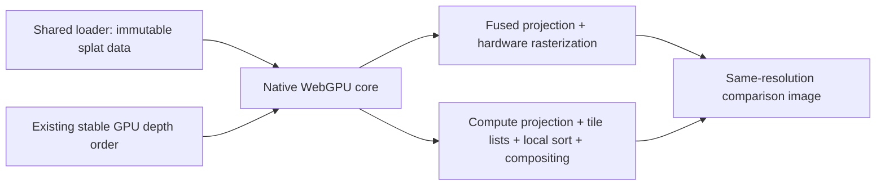

# Standalone Quest rendering core — research build

This is a separate **QA prototype**, not the published Experimental player.
The live player remains source revision `05b84443df6f`. No new user setting,
UI, server process, backend change, or rendering fallback was added.

`core.mjs` uses WebGPU directly and imports no rendering engine. `core.wgsl`
owns projection, procedural triangle generation, Gaussian evaluation, tile
binning/sorting, compositing, and contribution analysis. `probe.mjs` is only an
adapter: it imports the existing loader's decoded static data and covariance,
supplies the existing stable GPU depth order, and compares images. Global depth
sorting, asset loading, navigation, and XR presentation are not rewritten here.



## What the core comparison established

Quest 3 / Meta Browser 154.1.0.32.54.1101200317, 30 October 2026. These are
**isolated, frozen, one-view GPU-stage timings**, at 1680x1760, with captured
Quest eye projection/eye offset and radial ordering. They are **not live stereo
XR frame times or FPS**. The scene is in its restored desktop state after XR
exit; the capture does not preserve every immersive scene-placement transform.
The native samples average eight GPU timestamp measurements after one warmup.
The reference is the most recent matching engine Forward-pass GPU timestamp,
not a statistical confidence interval. Earlier repeats are consistent with the
direction, but a live XR A/B is still required before publication.

| Matched draw stage | Engine control | Standalone fused draw |
| --- | ---: | ---: |
| Original, 1,174,066 splats | 7.93 ms | 6.40 ms |
| Dense, 1,175,708 splats | 16.78–17.04 ms | 14.68–14.92 ms |

The control uses full triangle footprints and 32-bit ordering, to match the
prototype, rather than the published release's 0.8 small-footprint / 24-bit
defaults. The approximately 12–19% draw-time reduction therefore must **not**
be advertised as an additional 12–19% improvement over the live player.
In an authored-camera comparison, the difference was smaller: 21.82 ms versus
21.16 ms. Removing engine machinery alone does not explain a missing 2x gain.

Fused rendering retains every splat and the same Gaussian, alpha cutoff,
minimum size, and resolution. RGB RMS against the control is 0.117/255 on the
original and 0.212/255 on the dense scene; maximum RGB deltas are 5 and 3.
Only one original-scene pixel differs by more than four levels. Alpha maximum
is two levels. Visible-region RMS is also recorded (0.425 and 0.270), since
whole-image metrics can be diluted by empty background. Reference repeats are
pixel-identical. Accepted runs have no captured GPU validation errors.

## Alternatives tested in the new core

| Architecture, dense captured eye view | GPU stage cost | Result |
| --- | ---: | --- |
| Separate projection buffer, then hardware draw | 21.52 ms | Extra pass/storage outweighed saved vertex math |
| Fused hardware draw | 14.68 ms | Best complete draw path in this test |
| Front-to-back hardware draw, eight depth batches with opacity occlusion | 16.88 ms | Slower; changed RGBA8 accumulation also increased image error |
| 8x8 compute tiles, local sorting and contribution analysis | 270.67 ms | Not a real-time replacement on this device |

The earlier tiled compositor without contribution atomics also lost badly
(about 202 ms in the dense authored view with 16x16 tiles). Counting contributions
adds work; its 270.67 ms result is explicitly an analysis pass, not a renderer
speed claim. Smaller tiles avoided an original-scene list overflow but did not
make the design competitive. All current overflows fail the probe instead of
silently dropping splats. The 320x320 / 2048-entry preliminary overflow cases
and an early missing import-uniform binding were excluded.

A diagnostic that rejects every pixel at depth testing still costs about
8.00 ms in the dense captured eye view. This runs vertex/binning work and produces
an intentionally empty image; it is not a usable renderer or a valid FPS gain.

## Visibility headroom, not a shipping optimization

The software compositor also measured each splat's maximum transmitted RGBA
contribution. At a 1/1024 cutoff, 960,968 original splats (about 82%) and
1,098,019 dense splats (about 93%) still contributed. A second draw using that
**same-view visibility oracle** took 5.41 ms and 12.35 ms respectively, with
small RGB error. Computing the oracle cost 149.38 ms and 270.67 ms, and moving
the camera invalidates it. Those draw numbers exclude preparation and **must
not be presented as a real-time speedup** or used as a frozen visibility cache.

This suggests that simple occlusion removal alone is unlikely to halve work on
these scenes. The next core design should retain hardware rasterization and
investigate a spatial hierarchy with image-error-controlled aggregation: reduce
primitive work while preserving fine details as the camera approaches. Shared
stereo inputs and compact scene buffers should be part of that design. A generic
compute-tiled port, a blind library swap, or stale-frame reuse are not justified
by these measurements. This is a direction to test, not a proven quality or
performance guarantee.

Relevant primary research includes [WebSplatter](https://websplatter.github.io/),
[TileGS](https://arxiv.org/abs/2609.03613),
[opacity-based occlusion culling](https://diglib.eg.org/items/e87f07bc-8702-4c07-aabf-b4bc205a75b1),
and the user's [CUDA rasterizer analysis](https://grgkopanas.github.io/3dgs_cuda_blog/).
The native desktop papers are architectural references, not Quest benchmarks.

## Reproduce

Use one explicitly marked HTTPS QA tab with `quest-benchmark=1`, the scene's
normal `content` URL, and `support=1&sortbits=32&sortdistance=0.001`. From NextPlayer:

```sh
npm run build:quest-experiment
node experiments/quest-static/run-quest.mjs TARGET static-cov-subgroup2-triangle 52888
node experiments/quest-native/run-probe.mjs TARGET 1680 1760 fused,tiled,pruned 8 left
node experiments/quest-native/run-probe.mjs TARGET 1680 1760 draw,fused,occlusion,depth-reject 8 left
```

The first runner captures the headset's eye matrices before ending XR through
the engine. Omit `left` for an authored-camera test; `right` selects the other
captured eye. `--load-only` on the first runner loads QA code without a timing
run, but does not capture eye matrices. It intercepts only that marked tab.
`run-probe.mjs` accepts updated standalone core/shader source without rebuilding
the loader. Camera, updates, render state, GPU buffers and listeners are restored
or released on completion/error. Only one contiguous static source, unit exposure,
linear tone mapping, and non-custom/non-AA geometry are supported by this probe.

`measurements.json` contains numeric evidence; raw data and scene pixels remain
in ignored research/output directories. Approximately 255 MB of scratch buffers
are allocated by the combined testbed; the fused draw itself does not need the
tile-list/projected-data allocations. This is not a production memory layout.
